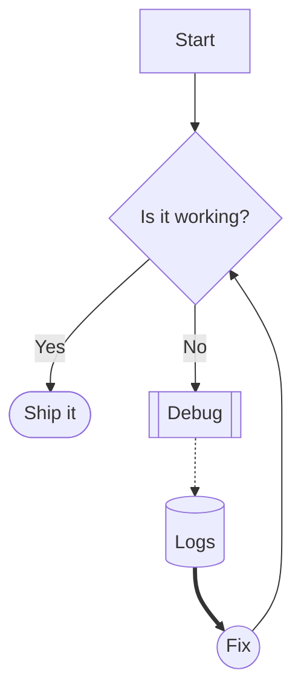
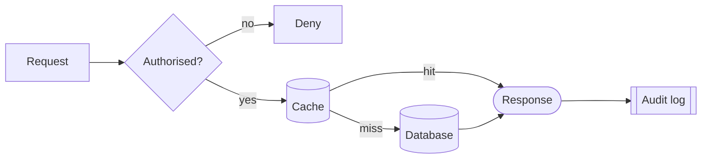
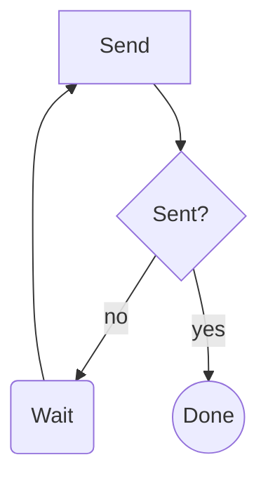

# Mermaid flowcharts

A fenced code block with the language `mermaid` holds a diagram. Taskboard draws
[Mermaid](https://mermaid.js.org/syntax/flowchart.html) **flowcharts** written in a small,
strict subset of its syntax, in the theme's colours. GitHub and other Markdown viewers that
support Mermaid draw the same block, so the file stays readable everywhere.

````markdown

````

Other diagram types (`sequenceDiagram`, `classDiagram`, `pie` and so on) aren't drawn. The
viewer shows their source with a note saying only flowcharts are supported.

## Header

The first line that isn't blank or a comment is `flowchart` or `graph`, optionally followed
by a direction:

| Direction    | Ranks run      |
|--------------|----------------|
| `TD` or `TB` | top to bottom (the default) |
| `BT`         | bottom to top  |
| `LR`         | left to right  |
| `RL`         | right to left  |

Statements go on separate lines, or are separated by `;`, as in
`graph LR; A --> B; B --> C`. Lines that start with `%%` are comments. These are skipped,
since the theme decides how a chart looks:

- `%%{init: ...}%%` directives, including ones that run over several lines
- a YAML front matter block at the very start, between two `---` lines (`title:`,
  `config:` and so on)

## Nodes

A node is an id, optionally followed by its shape and text. Ids are letters and digits (in
any script), `_` and `-`. A node that's never given text shows its id. The statement
keywords below (`style`, `class`, `click` and so on) can't be used as ids.

| Syntax            | Shape |
|-------------------|-------|
| `A` or `A[text]`  | rectangle |
| `A(text)`         | rounded rectangle |
| `A([text])`       | stadium |
| `A[[text]]`       | subroutine |
| `A[(text)]`       | cylinder (database) |
| `A((text))`       | circle |
| `A{text}`         | diamond (decision) |
| `A{{text}}`       | hexagon |

- Text can be quoted, `A["text with [brackets]"]`, to hold characters that would otherwise
  close the shape.
- `<br>` breaks a line. Text wider than 200 pixels also wraps at its spaces.
- When a node is defined more than once, the last definition sets its shape and text.

## Links

| Syntax | Link |
|--------|------|
| `A --> B`  | arrow |
| `A --- B`  | line, no arrowhead |
| `A -.-> B` | dotted arrow |
| `A -.- B`  | dotted line |
| `A ==> B`  | thick arrow |
| `A === B`  | thick line |
| `A <--> B` | arrowheads at both ends (also `<-.->` and `<==>`) |

- **Text:** `A -->|text| B`, or `A -- text --> B`. The second form works for the other
  strokes too: `A -. text .-> B` and `A == text ==> B`.
- **Length:** each extra `-`, `=` or `.` makes the link at least one rank longer, so
  `A ---> B` puts `B` two ranks below `A`. A link can span at most 10 ranks this way.
- **Chains:** `A --> B --> C` links A to B and B to C.
- **Groups:** `A & B --> C & D` links each of A and B to each of C and D.
- A node can link to itself (`A --> A`). The loop is drawn on its right, or underneath it
  when the chart runs left to right.

## Ignored statements

Colours always come from the theme, so these statements are accepted and skipped:
`classDef`, `class`, `style`, `linkStyle`, `click`, `accTitle` and `accDescr` (including
`accDescr { ... }` over several lines).

## Not supported

Each of these is an error that names its line, rather than something drawn wrongly:

- subgraphs: `subgraph`, `end` and `direction`
- classes on nodes: `A:::name`
- other arrowheads: `--x`, `--o`
- invisible links: `~~~`
- other shapes: `A>text]`, `A[/text/]`, `A[\text\]`, trapezoids, `A(((text)))` and
  `A@{ shape: ... }`
- more than 150 nodes or 300 links in one flowchart
- a link longer than 10 ranks (`A ------------> B`, with 12 dashes, is too long)
- a chart too big to draw even within those limits: more than 600 ranks (the extra
  rank each labelled link adds in the middle counts), or links bending more than 10,000
  times in all on their way past other ranks. These errors don't name a line.

## How flowcharts are drawn

- Nodes are placed in ranks along the chart's direction, ordered across each rank to keep
  links from crossing. A link that spans several ranks bends around the nodes between,
  and a link's text sits halfway along it.
- Links that would make a cycle still point the way they were written; they just run
  against the chart's direction.
- Nodes use the theme's card colour with a border, links its muted text colour, and link
  text sits on the panel colour.
- A chart wider than the space it's in is scaled down to fit, to 60% at the least. Past
  that, it scrolls sideways.

## Errors

When a flowchart is invalid, the viewer shows the error and the block's source, with the
error's line marked, instead of a diagram. Some examples:

```text
`subgraph` isn't supported: only nodes and links are drawn
`[` isn't closed: expected `]`
the link doesn't lead to a node
unknown direction `XY`: use TD, TB, BT, LR or RL
cross and circle arrowheads (`--x`, `--o`) aren't supported
```

## More examples

Left to right, with labelled and longer links:



A retry loop:


